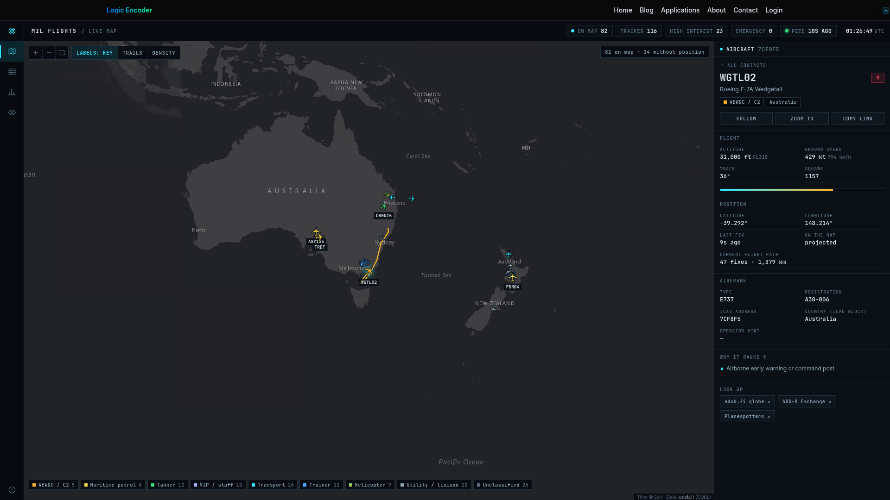

# Military Flights Monitor

Publicly visible aircraft activity is hard to read in a long list of positions and hex identifiers. Military Flights Monitor turns the military aircraft broadcasting on open ADS-B into a live map console with a searchable board, activity charts and an intelligence view.

Every aircraft carries a category, an interest score from 1 to 10 and a plain-language reason for that score, so a visitor can see at once which contacts deserve a closer look. Visitors explore the map and share a link to one aircraft; researchers filter the board and export it to CSV; site owners embed the whole console with a single shortcode.

Open the [live monitor](https://logicencoder.com/military-flight-tracker/).

## Tech stack

| Layer | Technologies |
|---|---|
| Worker | Python, SQLite sighting log |
| Plugin | PHP 7.4+, WordPress 6.0+, REST ingest, shortcode |
| Interface | JavaScript, Leaflet 1.9.4 (bundled), SVG charts |
| Map tiles | Esri dark grey base and reference layers |
| Data source | adsb.fi open data, military feed |
| Live updates | Polling every 15 seconds |
| Tests | Node.js and Python unit tests |

## Follow aircraft on the live map

The **Live map** is the main view: dark Esri tiles, one plane symbol per aircraft rotated to its track and coloured by category, zoomed between levels 2 and 12. The header counts **On map**, **Tracked**, **High interest** (score 6 or higher), **Emergency** and **Feed**, whose indicator is green below 2 minutes of snapshot age and amber below 10, with a UTC clock beside it.

The map tools zoom in and out, **Fit all aircraft**, and cycle **Labels** between Key, All and Off. **Trails** draws the current flight path of every aircraft, and **Density** shades the sightings of the last 14 days on a 2-degree grid. The legend lists the categories present with counts: click to hide or show one, Alt-click to show only that one. Between updates, aircraft move by projecting their last reported speed and track for at most 60 seconds; older positions are drawn faded. Labels, layers and sort order are remembered in the browser.

The value is orientation: the picture answers which aircraft are up, where, and which of them matter, before any table is opened.

## Inspect one aircraft

The **Contacts** panel beside the map lists every aircraft with search ("Callsign, type, reg, country…") and a sort of Interest, Altitude, Speed, Callsign or Category. Aircraft without a broadcast position sit in a separate **No position** group that can be shown or hidden. Selecting a contact turns the panel into its card: **Flight** (altitude with flight level, ground speed in knots and km/h, track, squawk), **Position** (latitude, longitude, last fix, and whether the symbol is observed, projected or a stale fix), **Airframe** (type, registration, ICAO address, country from the ICAO block, operator hint from the callsign) and **Why it ranks**.

**Follow** keeps the aircraft centred, **Zoom to** frames it and **Copy link** shares exactly that aircraft. **Look up** opens the adsb.fi globe, ADS-B Exchange or Planespotters for the registration.

The value is explanation: the score is never a bare number, because reasons such as an orbit pattern or an emergency squawk are listed next to it.

<!-- TODO(screenshots, 2026-11-21): aircraft detail card -->

## Sort and export the board

The **Board** lists every tracked military aircraft, including those without a position. Its columns are Callsign, Category, Type, Airframe, Reg, ICAO, Country, Alt ft, GS kt, Trk, Squawk, Position and Score; a click on a heading sorts and a second click reverses it.

Search, an **All categories** selector and **With position only** narrow the list, the count shows how many of the tracked aircraft remain, and **CSV** downloads exactly that view. A click on a row opens the aircraft on the map. Emergency squawks 7500, 7600 and 7700 are highlighted.

The value is a working list that can be filtered, sorted and carried into a spreadsheet.

<!-- TODO(screenshots, 2026-11-21): board -->

## Read the activity of the last two days

The **Activity** view opens with six figures: Tracked now, With position, High interest, Airframe types, Countries and Seen in 14 days. **Ops tempo · 48 h** charts distinct aircraft per hour in UTC, with the high-interest share in amber and the peak hour in the header.

Four bar panels follow: **Category mix**, **Top airframe types** (eight shown), **Altitude bands** from Ground to 30,000 ft and above, and **Countries** (eight shown) derived from the ICAO address block.

The value is context: whether the present count is ordinary or unusual for the last two days.

<!-- TODO(screenshots, 2026-11-21): activity -->

## Spot patterns in the intelligence view

The **Intel** view has four tables. **On station** lists aircraft airborne now that stayed inside a small box for the last hours; **Close pairs** lists aircraft within 30 km on a matching heading, speed and altitude, tagged **TANKER** when one of them is a tanker and marked as a possible formation otherwise; **First seen · 24 h** shows airframes new to the 14-day log; **Most tracked · 14 days** ranks airframes by sightings and shows when the history was last analysed.

Rows for aircraft that are airborne carry a live dot, and a click opens them on the map.

The value is selection: repeated behaviour and new arrivals surface without scanning the whole board.

<!-- TODO(screenshots, 2026-11-21): intel -->

## Check what the data means

The **About** view explains the picture. It says what is shown, that country comes from the ICAO address block rather than from where the aircraft flies, and that flight paths show the current flight only and break at a reporting gap over 20 minutes. A four-step pipeline lists the source feed, the worker, the WordPress ingest and the page.

A table covers the 14 categories with typical airframes, their score and a live count, plus the emergency squawk row scored 11. **Feed status** shows the source snapshot time, its age, delivery to the site, history analysis time, aircraft in the snapshot, airframes in the 14-day log and the last update check.

<!-- TODO(screenshots, 2026-11-21): about -->

## Share a type or embed the console

A page per airframe type opens the console with that type already filtered; clearing the **TYPE** chip returns to all aircraft. The same view is addressable from the link, so a view, an aircraft and a type filter can be shared.

Site owners place the `[mil_live]` shortcode in a page. The page checks for a newer snapshot every 15 seconds, receives aircraft only when the snapshot changed, and falls back to a message when JavaScript is off. In WordPress, the plugin's settings page lets an administrator regenerate the ingest key, and the bridge dashboard shows ingest activity for the last 24 hours.

## Scope and limits

The product uses publicly available ADS-B observations from adsb.fi under the ODbL licence. Only aircraft present in that military feed can appear: many aircraft fly with transponders off, and many operations are not represented. Ground transmitters are dropped, positions are projected for at most 60 seconds, and the history covers 14 days.

The source's coverage sets the boundary of the picture. Use the monitor to explore the observations it contains and keep that boundary in mind when sharing a result.

## Understand military air traffic at a glance

The visitor journey runs from the live map to one aircraft card, from there to a reason for its score, and on to a shared link. The research journey runs from the board and its CSV to the activity and intel views, which show tempo, stations and new airframes.

The site-owner journey is one shortcode, a source that refreshes itself and a page that states its own limits.

---

Private code: [military-flights-monitor-bridge](https://github.com/logicencoder/military-flights-monitor-bridge)

See [REPOS.md](REPOS.md) for related repositories.

**[Logic Encoder](https://logicencoder.com)** · [GitHub](https://github.com/logicencoder) · [Contact](https://logicencoder.com/contact/)
